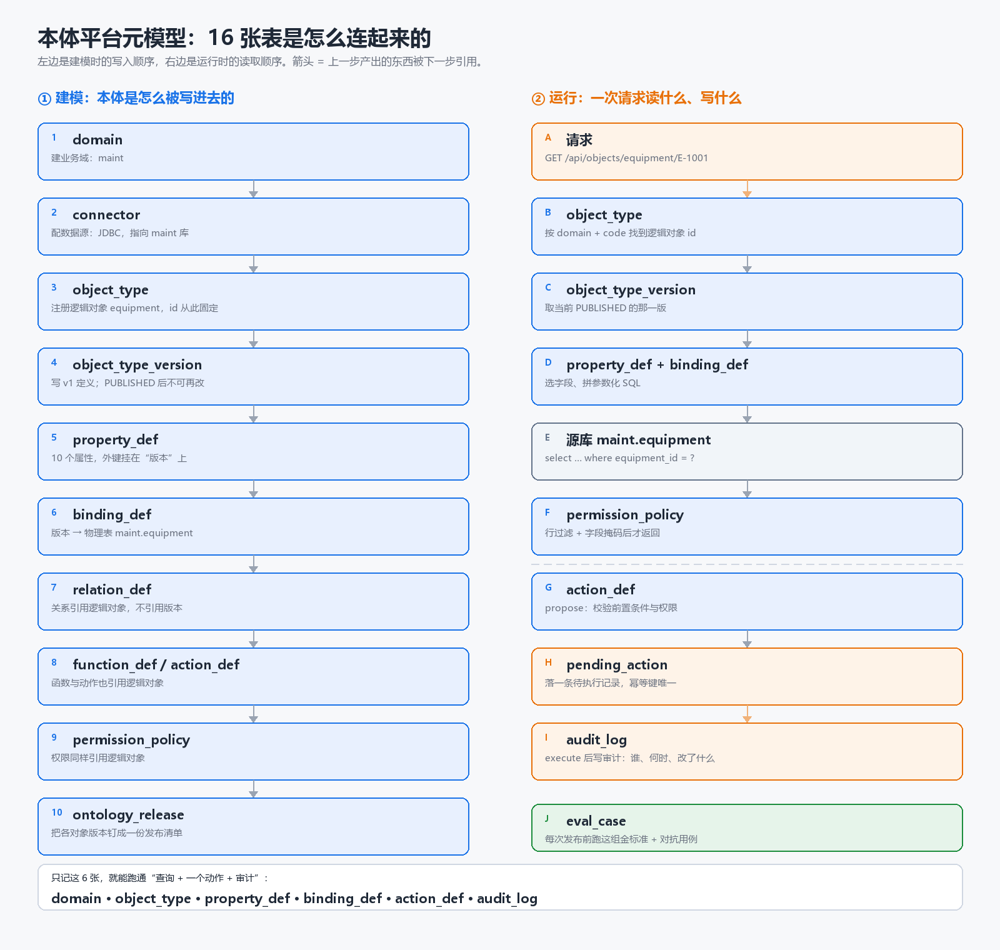

# 元模型怎么读：16 张表其实是 8 个问题



## 0. 先拆一个误解：schema 不是架构

`ont_meta` / `ont_rt` / `ont_eval` 不是三层架构，它们是**数据库里的命名空间**，作用等价于 Java 的包名：

```java
ont_meta.object_type        ≈  cn.zj.ontology.core.ObjectType
ont_rt.pending_action       ≈  cn.zj.ontology.runtime.PendingAction
ont_eval.eval_case          ≈  cn.zj.ontology.core.EvalCase
```

把表分进三个 schema，只有四个实际好处：

| 好处 | 具体表现 |
|---|---|
| **生命周期不同** | `ont_meta` 跟着 Git 走，可以整库重建；`ont_rt` 是真实发生过的记录，只能备份不能重建 |
| **权限不同** | 建模者能写 `ont_meta`，但只能读 `ont_rt`；运行时服务能写 `ont_rt`，但不能改 `ont_meta` |
| **保留期不同** | 审计要留 1–3 年，元模型要永久留，评测用例可随时删 |
| **爆炸半径** | 误迁移、误清表只影响一块，不会连累另一块 |

**但这层不是必须的。** V1 完全可以只建一个 `ontology` schema，表名加前缀 `meta_` / `rt_`，照样跑。分不分只影响运维，不影响模型本身。

判断标准是：**表的数据什么时候死、谁能碰、要不要备份**。三者不同才值得分 schema。现在这三条都成立，所以分了；等你觉得跨 schema 写 SQL 麻烦，合成一个也不算错。

## 1. 用 Java 类比，一次就懂

| 本体概念 | Java 里对应什么 | 表 |
|---|---|---|
| 业务域 | 模块 / package | `domain` |
| 逻辑对象 | 类的全限定名（`maint.Equipment`） | `object_type` |
| 对象版本 | 某个版本的类定义（编译产物） | `object_type_version` |
| 属性 | 字段 `Field` | `property_def` |
| 关系 | `@ManyToOne` / 外键 | `relation_def` |
| 数据绑定 | ORM 的 `@Table` / `@Column` | `binding_def` |
| 函数 | 只读方法（`@Transactional(readOnly = true)`） | `function_def` |
| 动作 | 带校验、审批、事务的写方法 | `action_def` |
| 权限 | Spring Security + 数据权限 | `permission_policy` |
| 发布 | 一次 `mvn release`，产物清单 | `ontology_release` |
| 审计 | 访问日志 / 业务操作日志 | `audit_log` |

**唯一的关键差异**：Java 的类在编译期就固定了；本体的"类"存在数据库里，所以可以运行时发布新版本、可以回滚，也不需要重启应用。

## 2. 16 张表 = 8 个问题

### 问题 1：这是谁的域？→ `domain`

| 一行长什么样 |
|---|
| `(D1, maint, 设备维保)` |

谁写：建模者。谁读：几乎所有地方。

### 问题 2：数据从哪来？→ `connector`

| 一行长什么样 |
|---|
| `(C1, D1, maint-pg, JDBC, {"schema":"maint"}, secret/maint-pg)` |

口令不落库，只存 `secret_ref` 指向密钥管理。

### 问题 3：业务里有什么东西？→ `object_type`

| 一行长什么样 |
|---|
| `(O1, D1, equipment, 设备)` |

这一行只有"身份"，没有字段。**id 一旦生成就永不改变**，这是后面所有引用的锚点。

### 问题 4：这个东西长什么样？→ `object_type_version` + `property_def`

```
(O1) ──< object_type_version: (V1, O1, v1, PUBLISHED) >── property_def × 10
```

| `object_type_version` | 说明 |
|---|---|
| `(V1, O1, 1, PUBLISHED, id, 9f2c…)` | 版本 1，主键属性 `id`，schema hash |

| `property_def` | 说明 |
|---|---|
| `(P1, V1, code, 设备编码, STRING, required=true)` | 属性挂在**版本**上，不挂在逻辑对象上 |
| `(P2, V1, criticality, 关键度, ENUM, {"enum":["A","B","C"]})` | 值域写在 `type_config` |

为什么属性挂在版本上：v2 加字段时，v1 的属性集合必须保持原样，否则回滚就回不去了。

### 问题 5：字段从哪张表来？→ `binding_def`

| 一行长什么样 |
|---|
| `(B1, V1, C1, TABLE, maint.equipment, {"id":"equipment_id"}, {"status":"eq_status"})` |

一个版本一份绑定。换数据源只改这里，逻辑对象和动作都不动。

### 问题 6：对象之间怎么连？→ `relation_def` + `relation_binding`

| `relation_def` | 说明 |
|---|---|
| `(R1, D1, siteEquipment, 站点包含设备, O2→O1, ONE_TO_MANY)` | 引用**逻辑对象** O2、O1 |

| `relation_binding` | 说明 |
|---|---|
| `(RB1, R1, C1, FK_COLUMN, {"from":"id","to":"site_id"})` | 语义与物理连接分开 |

### 问题 7：能算什么？→ `function_def`

| 一行长什么样 |
|---|
| `(F1, D1, overdueDays, 保养超期天数, implKey=maintOverdueDays, input/output schema)` |

只有计算，没有副作用。写操作不在这里。

### 问题 8：能做什么、谁能做？→ `action_def` + `permission_policy`

| `action_def` | 说明 |
|---|---|
| `(A1, D1, createWorkOrder, target=O1, 参数 schema, 前置条件, 幂等键, side_effects)` | 唯一写入口 |

| `permission_policy` | 说明 |
|---|---|
| `(PM1, D1, ROLE, maint_technician, O1, READ, ALLOW, "site_id = ${user.siteId}")` | 权限也是数据 |

### 剩下三张：发布、运行、评测

| 表 | 一行长什么样 | 作用 |
|---|---|---|
| `ontology_release` | `(REL1, D1, 2026.10.1, PUBLISHED, {"equipment":1,"site":1})` | 把一组版本钉死，staging 验过哪份就上哪份 |
| `pending_action` | `(PA1, idem-key, assignTechnician, WO-7, PROPOSED)` | 提议了但还没执行的动作 |
| `audit_log` | `(trace-9a, agent-1, INVOKE, overdueDays, latency=12ms)` | 谁、用哪版、碰了哪些对象 |
| `object_cache` | `(equipment, E-1001, {...}, 2026-10-22T10:00)` | 只有 CACHE/CDC 模式才有数据 |
| `eval_case` | `(EC1, D1, gold-001, GOLD, "3 号泵站有哪些 A 类设备")` | 发布前必须跑绿的用例 |

## 3. 关联关系：一次建模的插入顺序

这是理解这 16 张表最快的方式——按顺序插入，看 id 怎么被引用。

```sql
-- 1. 建域
insert into domain values ('D1', 'maint', '设备维保');

-- 2. 配数据源
insert into connector values ('C1', 'D1', 'maint-pg', 'JDBC', ...);

-- 3. 注册逻辑对象（拿到 O1）
insert into object_type values ('O1', 'D1', 'equipment', '设备');

-- 4. 写版本（拿到 V1）
insert into object_type_version values ('V1', 'O1', 1, 'PUBLISHED', 'id', '9f2c');

-- 5. 属性挂在版本 V1 上
insert into property_def values ('P1', 'V1', 'code', '设备编码', 'STRING');

-- 6. 绑定也挂在版本 V1 上
insert into binding_def values ('B1', 'V1', 'C1', 'TABLE', 'maint.equipment');

-- 7. 关系引用逻辑对象 O2 → O1，不是 V2 → V1
insert into relation_def values ('R1', 'D1', 'siteEquipment', 'O2', 'O1');

-- 8. 动作引用逻辑对象 O1
insert into action_def values ('A1', 'D1', 'createWorkOrder', target => 'O1');

-- 9. 权限引用逻辑对象 O1
insert into permission_policy values ('PM1', 'D1', 'ROLE', 'maint_technician', 'O1');

-- 10. 发布：把 (equipment=v1, site=v1) 钉成一份清单
insert into ontology_release values ('REL1', 'D1', '2026.10.1', 'PUBLISHED', '{...}');
```

**第 7、8、9 步用的是 `O1`，不是 `V1`。** 这一条是全套设计的枢纽：

- 发 v2 时，新增 `(V2, O1, 2)`，属性挂 V2，绑定挂 V2；
- 动作、权限、关系还指着 O1，一行都不用改；
- 运行时按 `O1 → 当前 PUBLISHED 版本` 解析，自然用上 v2。

如果第 8 步写成 `V1`，发 v2 后动作就永远指向旧版本——这就是我上一版设计里被你问到的那个缺陷。

## 4. 运行时：一次查询读什么

```
GET /api/objects/equipment/E-1001
  ↓
1. domain(code=maint)                      → D1
2. object_type(D1, code=equipment)         → O1
3. object_type_version(O1, PUBLISHED)      → V1
4. property_def(V1) + binding_def(V1)      → 选字段、拼 SQL
5. 源库 maint.equipment                     → 取到一行
6. permission_policy(O1, READ, 当前主体)    → 行过滤 / 字段掩码
7. 返回对象卡片 + audit_log 写一条
```

注意第 5 步：**数据根本没进本体库**。本体库只存"怎么查"，不存"查到了什么"。

## 5. 运行时：一次动作写什么

```
POST /api/actions/assignTechnician:propose
  ↓
1. action_def(code, PUBLISHED)             → A2，拿到参数 schema 和前置条件
2. 解析 REF 参数 technicianId               → 读出 technician 对象
3. 校验 precondition_expr                   → 不满足直接拒
4. permission_policy(PROPOSE)               → 没权限直接拒
5. 算幂等键 → insert pending_action          → 状态 PROPOSED
6. 按 approval_policy 决定                    → APPROVED / REJECTED

:execute
7. 再校验一次（防并发）                       → 
8. 写业务库 EAM                              → 
9. update pending_action                     → EXECUTED / FAILED
10. insert audit_log                          → 谁、何时、改了什么
11. 失败且 compensable → 调补偿动作            → COMPENSATED
```

**动作先落库再执行**，这是和普通 CRUD 最大的区别：因为要审批、要幂等、要补偿、要审计，这四件事都要求"执行前有一个可追踪的中间态"。

## 6. 如果 16 张表让你卡住：先建 6 张

真的不用一次全建。最小可跑集是：

```
domain + object_type + property_def + binding_def + action_def + audit_log
```

这 6 张能支撑：**定义一个对象 → 能查 → 能做一个动作 → 有审计**。剩下的 10 张解决的是版本演进、关系遍历、权限、评测、缓存——都可以等跑通后再加，且加的时候不改前面 6 张的结构。

V1 的 DDL 里这 6 张是全集的前 6 张，不是另一套表。

## 7. 怎么查字段说明

DDL 里 16 张表、161 个字段全部带 `COMMENT`，不用翻代码：

```sql
-- psql：看单表（含字段说明）
\d+ ont_meta.action_def

-- 一次性导出全部字段说明
select n.nspname, c.relname, a.attname, d.description
from pg_class c
join pg_namespace n on n.oid = c.relnamespace
join pg_attribute a on a.attrelid = c.oid and a.attnum > 0 and not a.attisdropped
left join pg_description d on d.objoid = c.oid and d.objsubid = a.attnum
where n.nspname in ('ont_meta', 'ont_rt', 'ont_eval')
  and c.relkind = 'r'
order by n.nspname, c.relname, a.attnum;
```

注释里除了字段含义，还写了两类信息：**取值枚举**（如 `PROPOSED` / `APPROVED` / …）和**谁维护它**（如 `updated_at` 由哪个触发器更新、`impl_key` 对应 Spring Bean）。改表结构时请一并改注释，`tools/check_comments.py` 会在 CI 里校验有没有漏。

## 8. 常见误解

**Q：`domain` 和数据库 schema 是一回事吗？**
不是。`domain` 是业务域（一行数据），`ont_meta` 是数据库命名空间。一个业务库 schema `maint` 可以被多个 domain 引用，一个 domain 也可以跨多个库。

**Q：为什么不直接存一个大 JSON 描述整个本体？**
可以，但影响分析会变得极难：改一个属性，要遍历所有 JSON 找引用。行式存储 + 外键让"谁引用了它"变成一句 SQL。折中方案是版本表存 `schema_hash`，属性仍然行式。

**Q：为什么 `function_def` 和 `action_def` 不合成一张"能力表"？**
因为只读和可写是硬边界。合成一张后，运行时必须在每个函数上判断"这个能不能写"，判断漏一次就是生产事故。分表让边界在 schema 层就成立。

**Q：`pending_action` 为什么不直接写业务库？**
审批可能等几小时，幂等键要唯一，失败要补偿——这三件事都需要一个不依赖业务库事务的中间态。

**Q：`audit_log` 为什么不存对象全量快照？**
体积和隐私。存 `trace_id` + 摘要 + 碰过的对象 id，需要细节时按 trace 回查业务库。

**Q：为什么关系没有版本？**
已知债务。`relation_def` 引用逻辑对象是对的，但 join 列名随 schema 变化时绑定可能失效。V2 要么给关系加版本，要么发布时校验列存在。这条写在 `docs/01-meta-model.md` 的留白里。
